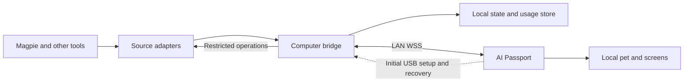

**English** · [简体中文](agent-pet-design.zh_CN.md)

# Agent Pet: Product and Technical Design

Status: proposal. Firmware, plugins, and bridge are not implemented. Protocols, resource budgets, and interactions below are design targets pending validation, not existing capabilities. Hardware baseline: ESP32-C3, 8 MB Flash, no PSRAM, 240x320 color display, three buttons, ES8311 audio, Wi-Fi, and BLE. Upstream baseline: `488beda41309f052d81f08d0016d65a3fd85eb7e`.

Phone provisioning and away-from-computer connectivity are in scope; see [Phone Provisioning and Remote Use](mobile-remote.md).

## 1. Product goal and scope

Give people using multiple AI tools a portable work companion: see what is running, what needs attention, and today's usage; press a button to return to the relevant task. The computer aggregates data. The device animates the pet locally without continuous model calls or additional inference costs.

Magpie is the first source, behind an adapter interface for future tools. Model branding, actual model identity, and pet skin are separate settings. A DeepSeek whale is the first candidate; a Claude-themed character is another option. Before producing final assets, verify official references and usage terms, retain attribution/license records, and do not label unverified interpretations as official characters.

| Stage | Scope | Exit criterion |
| --- | --- | --- |
| P0: prove the connection | Simulated events, USB pairing, Wi-Fi, encrypted state synchronization, placeholder pet | Stable display on real hardware, reconnect recovery, measured memory and power |
| P1a: local daily use | Real Magpie adapter, multiple tasks, attention alerts, usage, open task on computer, privacy/settings | A working day of reliable use with traceable state and statistics |
| P1b: phone and remote | Secure BLE setup/enrollment/network changes, hotspot, relay read-only status, switching/revocation | Phone-only onboarding, cross-network updates, explicit offline-source state |
| P2: richer interaction | Explicitly supported answers/cancel/retry, voice inbox, daily recap, additional skins | Verify host APIs, permissions, and each interaction; detailed approvals stay on host |
| P3: expansion | Other tools, multiple computers, continuous BLE gateway, E2EE, signed OTA | Separate resource, authorization, operations, and hardware acceptance |

Default: one source computer and one device; prefer LAN with optional remote relay outside LAN, while local functions remain independent. Secure phone BLE and USB are setup paths. Cover desktop and travel, with public mode when worn. Continuous Wi-Fi/hotspot does not imply all-day battery. Computer sleep leaves only last state; ongoing updates require an online source host.

## 2. Pages, buttons, and pet behavior

Implement a new application UI. Reuse BSP and isolated logic, not the upstream hardware-test menu or screens.

Four home pages: Now, Tasks, Usage, Inbox. Show connectivity and battery at the top; unavailable battery is unknown. Now centers the pet with running/attention counts and one important task. Details scroll so long titles do not consume the entire display.

| Input | Home pages | Lists/details |
| --- | --- | --- |
| UP / DOWN click | Switch the four pages | Move focus or scroll |
| OK click | Enter page content | Open details or select a labeled operation |
| OK hold, 500 ms | Open local menu | Return one level |
| Local menu | Settings, focus/public mode, pet interaction, provisioning/pairing | Important actions have explicit text labels |

Do not rely on chords or double-click. Clicks should not wait for an additional double-click window. Design voice capture separately in P2 so hold-to-return does not conflict with recording. Forget network, unpair, and erase all data are separate confirmed actions. Initial USB setup requires no long passwords on the device.

| State | Pet | Information and interaction |
| --- | --- | --- |
| Idle | Rest or wander | Daily overview |
| Working | Read, type, handle tools | Phase and elapsed time; generic running if unknown |
| Needs you | Hold a sign, look toward user | Question/review summary and host task link |
| Success | Deliver a package | Result summary and mark read; acceptance remains separate |
| Failure | Ask for help | Error category and details; never claim retry succeeded prematurely |
| Disconnected | No-signal cue | Last synchronization time, no apparent live work |
| Sleeping | Sleep | Deep sleep cannot receive live updates; resynchronize on wake |

An invalid-connection banner remains visible. Main content priority: pending interaction, failure, running, unread completion, idle. Break ties by waiting age and update time; allow pinning a task. Preserve individual statuses so one running agent does not hide another's question.

Show thinking, coding, searching, or testing only when explicitly reported. Tool names do not prove success; never expose private reasoning. No percentage without a trustworthy denominator. Inactivity means possibly stalled, not failed. Mood is not evidence of task outcome.

Completion and acceptance are separate: `completed` is a host outcome; `accepted` means the user checked the work. Reward acceptance and inbox organization rather than token consumption. Avoid streak penalties, artificial hunger, or spending pressure.

Default alerts cover new attention requests, failures, and completions. Focus mode alerts only for attention/failure. Combine alerts within 10 seconds; ordinary sounds are at least 60 seconds apart. Quiet hours, volume, and brightness are configurable. Do not speak task contents by default. Recovered offline completions produce one recap, not repeated chimes. Priority never overrides mute.

## 3. Sources and confidence

Host adapters produce a common data model; the bridge normalizes, persists, and communicates with devices. The device never reads session databases, holds provider API keys, or invents host billing.

| Data | Required source | Missing-data behavior |
| --- | --- | --- |
| Tasks/runs | Host session/run identity and lifecycle | Unknown, not fabricated progress |
| Agents/subtasks | Explicit parent/child relationships and state | Display only confirmed relationships |
| Phase | Explicit tool/stage events | Running and last activity |
| User attention | Explicit question/review with a live request ID | A question mark in text is not a pending interaction |
| Tokens | Host deltas or totals with documented accounting | Unavailable; never add both forms |
| Money | Actual billing or model-price estimate | Separate actual/estimated; unknown without prices |
| Subscription quota | Official provider or explicit host interface | Never derive remaining quota from tokens |
| Open task | Verified host navigation capability | Companion navigation or manual location |

Negotiate `capabilities`; report only confirmed capabilities. Disconnect, cancellation, failure, waiting, and completion are distinct. A failed tool does not automatically fail the overall task. If parent usage includes child usage, do not count the children again. Late usage can revise daily totals after a task ends.

Identity includes `source_id + session_id + run_id`, plus parent run and source event IDs. Different runs of one session remain distinct. Goals, turns, background jobs, and workflows carry `entity_kind`; a finished turn is labeled as a finished turn, not proof the user's goal succeeded. Only explicit completion for that entity or user acceptance advances the corresponding goal/task outcome. The device retains up to 16 summaries, prioritizing attention, failures, and active work. The computer keeps the rest; show total and omitted counts.

Execution and pending interaction are orthogonal: `execution_state` and `pending_interactions` can mean running while a question is open. Each interaction has a request ID, independent revision, expiry/resolution, and `blocks_execution`; resolving/expiring it need not stop work. Display `state` may prioritize waiting_user without discarding running. Separate `turn_outcome` from explicit `task_outcome`; without goal completion evidence, show turn ended/awaiting acceptance, not a goal-success animation. Source freshness `fresh/stale/unknown` is separate from outcome; disconnect does not rewrite the last known result.

Event deduplication alone is insufficient for tokens. Match stable DSH meter-record identity, revisions, and replacement/supersession; upsert and recompute affected aggregates. Final counters are nonnegative, but corrections may be negative. Retry/failed-attempt/replaced-record billing follows source semantics, never guessed billing. Without an accessible reducer, validate sanitized samples and equivalent reduction before enabling statistics. P1 promises verifiable tokens; money is an optional estimate, actual billing unavailable.

Money uses integer micro-units encoded as decimal strings: `"1840000"` USD means 1.84 USD. Include currency, actual/estimate provenance, price-table version, and measurement time. Token counters are also nonnegative decimal strings to avoid cross-language precision issues. Do not add USD and CNY directly. Converted display includes exchange-rate source/date. Unknown is `null`, never zero.

Daily aggregation uses the computer's configured IANA time zone and a new snapshot at midnight, including DST. Duration uses monotonic timing combined with host timestamps; device clock does not choose the billing day. Price corrections, collection gaps, and source coverage are visible on the computer.

## 4. Architecture and responsibilities



- Magpie plugin: observe permitted events, advertise capabilities, locate sessions; perform explicit operations only if the host supports them.
- Bridge: pairing, WSS, mDNS, normalization, snapshots, action validation, aggregation, sanitized diagnostics.
- Device: Wi-Fi and WSS clients, bounded state, pet animation, alerts, buttons; no complete history.
- Computer settings: select sources/projects, configure connectivity/budgets, inspect health, revoke devices, export sanitized diagnostics.

The bridge is a logical boundary. Embed it only after validating the plugin runtime, or run it as a local sidecar. Do not assume arbitrary Node.js socket/serial access or persistent background execution. Section 14 records host evidence.

Cross-process adapter/bridge IPC binds only to loopback and authenticates callers. Prefer a user-restricted local socket/named pipe; if local HTTP is used, require a separate session token, fixed methods, and Origin checks. Device transport and management API use separate ports/bindings; management is not exposed to the LAN.

Initially start the bridge manually and show both process and plugin connection health. Autostart is opt-in. Uninstalling the plugin must not leave an indefinite orphan process. Plugin stopped, Magpie exited, and computer sleeping are distinct conditions.

## 5. Network and onboarding

**LAN: Wi-Fi STA device initiates computer WSS. Remote: both bridge and device initiate relay WSS on 443.** No MQTT broker or home public port forwarding. Secure phone BLE and USB are supported setup paths; BLE runs only during timed setup to reduce memory contention. USB flow follows; phone enrollment and remote use are in the [mobile design](mobile-remote.md).

First-use flow:

1. Start the bridge, connect a data cable, and select the correct serial port in settings. Opening a port may reset the board; identify the device and explain this first.
2. Enter a timed pairing screen. Computer and device show a matching short code; confirm with device OK. The code confirms pairing, not an encryption key.
3. USB transfers selected 2.4 GHz SSID/credentials, bridge identity, private CA/public-key trust, a unique device credential, port/address candidates, and initial trusted time. Configuration frames are distinct from ordinary logs; never echo credentials.
4. Pairing expires after 120 seconds. Sensitive changes require that window plus physical confirmation. Another computer cannot silently replace an existing binding.
5. Join Wi-Fi, obtain DHCP, verify the server, authenticate, and download a snapshot. Show separate network connected, service connected, and data synchronized results.
6. Unplug USB after success. A USB connection alone does not configure Wi-Fi; power-only attachment is not a data link.

Remember at most three user-configured networks. Autojoin only these; no automatic open-network join. Store credentials in a dedicated application namespace. Verify Flash/NVS encryption feasibility and recovery during implementation; do not promise protection against physical extraction in the first version.

Computer firewall must allow the bridge's LAN port. Bind only to the chosen private interface, excluding VPN/public interfaces by default. Never automatically alter firewall/router settings. Proposed initial port: `7443`; on conflict choose another and update the device over a trusted channel.

| Environment | Behavior |
| --- | --- |
| Home/office LAN | Wi-Fi + WSS; Internet is unnecessary for state transport |
| Wired computer, wireless device | Works if router permits communication between interfaces |
| Phone hotspot | Away, only device joins the phone hotspot and reaches the online home computer through relay; if both share a hotspot, LAN reachability can also be tested |
| 5 GHz only | Unsupported; use 2.4 GHz or compatible mixed network |
| Guest/AP isolation | May block computer access; diagnose isolation rather than repeatedly asking for credentials |
| Enterprise 802.1X/captive portal | Unsupported initially; use personal hotspot or dedicated network |
| VPN/multiple interfaces | Select the reachable private interface, avoid unrelated network advertising |
| Different location/subnet | P1b optional relay; explicitly offline when disabled/unreachable |
| Computer sleeping/off | State ages; cloud tasks may continue, but a sleeping bridge cannot forward updates |

Discover `_agentpet._tcp.local` with mDNS, publishing only service ID, port, and protocol version. Never publish user/project names or credentials. Discovery supplies addresses, never trust. Try last address then mDNS; USB allows an explicit IP/hostname where multicast fails. Reconnect after DHCP changes using the same trusted identity. A new computer/certificate is not automatically trusted.

Continuous USB state transport is a separate P1 fallback adapter, enabled only after validating bidirectional framing, permissions, and reset behavior. USB logging support alone does not prove a complete fallback exists. Phone BLE setup is P1b with P0 validation of maintained secure provisioning/phone SDKs. Upstream BLUFI references networking, not account ownership or relay enrollment; see the [mobile design](mobile-remote.md).

## 6. Trust, authentication, and revocation

Use WSS with TLS 1.2 or later. Each bridge instance has a private CA/service certificate and stable identity. USB provisions trust root and public-key fingerprint. Validate chain, service name, validity dates, and pinned public key. Keep stable certificate name separate from changing IP, verifying the fixed name. Physically confirmed secure BLE can establish first phone trust. Relay uses formal domain certificates, separate credentials, and pretrusted signing identity; remote and LAN identities are distinct. ESP-IDF/mbedTLS/WebSocket compatibility with all these checks is a P0 gate; never ship with certificate verification disabled.

Cold boot has no trusted RTC time; a stored old timestamp is not current time. USB supplies initial time. Later cold boots/deep-sleep wakes first request signed time from the paired computer: a separate HTTP port, initially `7444`, exposes only `/v1/time`. Request a fresh 256-bit random nonce; return protocol domain `agentpet-time-v1`, bridge ID, matching nonce, integer UTC seconds, and signature. Verify with the USB-pinned public key over a fixed encoding: domain, restricted-character bridge ID, hexadecimal nonce, decimal seconds, newline-separated with no trailing newline. Require response within five seconds of monotonic time. Freeze ECDSA P-256/SHA-256 with DER signatures in the implementation schema and bound response size. Require the paired identity and matching nonce to prevent replay. This endpoint accepts no credentials, exposes no tasks, is rate-limited, and cannot change pairing.

The signature authenticates the paired computer's clock, not absolute time accuracy. Then perform full WSS chain/name/date/pin verification. Verify service signing-key correspondence and rotation with the pinned identity. mDNS may advertise the time port, never a replacement trusted key. P0 must test no-Internet cold boot after power loss and deep-sleep recovery. Until signed bootstrap is implemented, or on failure, explicitly require USB time repair; do not depend on unauthenticated SNTP or disable verification. Rotate roots/keys over an authenticated authorized connection or USB; lost trust requires physical confirmation.

Inside TLS, an `auth` frame presents a unique random credential of at least 256 bits. The server authorizes it before accepting business frames. Keep it out of URLs, discovery, and logs. Authentication timeout: 5 seconds. Invalid credentials disconnect and back off; unauthenticated connections have concurrency/rate limits. Computer credentials use OS secure storage or restricted user files. No provider API keys on device.

Revocation immediately disconnects and denies old credentials. The device shows authorization revoked rather than auto-registering. Local unpair destroys device credentials; the computer still manages revocation records. Factory reset clears networks, pairing, and private cache, but does not revoke a lost device on the computer; explain this in settings.

Physical storage extraction, a compromised computer, and malicious firmware are outside the initial protection claim. Public mode hides project names, question text, spending, and identity; sounds never announce these.

## 7. Protocol v1 draft

UTF-8 JSON over WSS. No streamed model tokens, image frames, or WebSocket compression. Assets stay local; states drive animations. No actions before version/capability negotiation. Ignore unknown optional fields; reject incompatible major versions with an upgrade prompt.

Envelope: `v`, `type`, `message_id`, `stream_id`, `revision`, `payload`. `stream_id` identifies a publication epoch for one device's filtered view. Change it when rebuilding state, changing visibility policy, or abandoning an unrecoverable queue; retain it on ordinary reconnect. `revision` is contiguous within that device publication stream, not a host event number or global database version. Filter permissions, select the top 16, and coalesce first; assign the next revision only to an actually published `state.delta`. Omitted intermediate states consume no sequence numbers. Heartbeat/control frames carry the current published revision without incrementing it. Start a new stream before exceeding JSON's safe-integer range. Recover gaps with snapshots.

Maintain a separate published projection per stream. Freeze that projection and baseline revision for a snapshot; number queued unpublished changes after snapshot completion. To jump to newer underlying state, start a new stream and snapshot. Global source counters would create false gaps after filtering/coalescing and must not serve as publication sequence numbers.

Handshake: TLS, `hello` with version/device/firmware identity, `auth`, `welcome` with capabilities/source health/time/limits, paginated snapshot, deltas.

| Type | Direction | Purpose |
| --- | --- | --- |
| `hello/auth/welcome` | Both | Negotiation, authentication, capability and health |
| `snapshot.begin/page/end` | Computer to device | Atomic replacement of tasks, usage, inbox, and state |
| `state.delta` | Computer to device | Replace one full summary, remove one, or replace aggregation; no JSON Patch |
| `heartbeat` | Computer to device | Liveness, source freshness, current revision |
| `ack/resync` | Device to computer | Applied revision or resynchronization request |
| `action.prepare/action.offer` | Both | Fresh action descriptor/token on entering details |
| `action/action.query/action.result` | Both | Execute, query by ID, explicit result |
| `view.configure/view.ready` | Both | Privacy mode/view_epoch confirmation followed by a new snapshot |
| `device.status` | Device to computer | Battery, signal, firmware; never network credentials |

Example task update; all identities are illustrative:

```json
{
  "v": 1,
  "type": "state.delta",
  "message_id": "msg-43",
  "stream_id": "stream-demo",
  "view_epoch": "view-demo",
  "revision": 43,
  "payload": {
    "op": "task.upsert",
    "task": {
      "id": "magpie:session-demo:run-demo",
      "entity_kind": "turn",
      "state": "waiting_user",
      "execution_state": "running",
      "pending_interactions": [{"request_id": "request-demo", "revision": 1, "blocks_execution": false}],
      "state_revision": 9,
      "title": "Website update",
      "phase": "needs_input",
      "progress": null,
      "updated_at": "2026-11-05T06:30:00Z",
      "request_id": "request-demo",
      "available_actions": ["open_on_host"]
    }
  }
}
```

Display states: `queued/running/waiting_user/completed/failed/cancelled/unknown`. Review/acceptance/read status are separate fields. Phase is optional; progress is 0..1 only with reliable host measurement. `task.upsert` replaces the complete summary; deletion uses `task.remove`.

Initial bounds: each complete message <=4096 bytes, including the total across WebSocket fragments; title <=96 UTF-8 bytes, summary <=256 bytes, <=16 tasks, <=8 inbox entries, <=4 actions per item. Truncate only on UTF-8 boundaries. Render plain text, reject control characters, deep objects, and abnormal arrays. Unsupported dynamic Chinese glyphs need a visible fallback and host details, not hidden missing-glyph boxes.

Snapshots contain at most four tasks per page and still obey byte limits. Usage/inbox are paginated too. `begin` declares snapshot identity, baseline revision, page count, and object counts. `page` carries identity and page number; `end` confirms completion. Receive into bounded staging structures and swap only after full validation; retain the old view marked synchronizing. A 10-second timeout, missing page, count mismatch, or conflicting duplicate discards staging and requests recovery.

During snapshots buffer subsequent changes and send them in order afterward. On overflow abort and create a newer snapshot instead of a gapped stream. Apply only contiguous business revisions for the current stream; ignore duplicates and resynchronize gaps. Reconnect always requests a full snapshot initially, so the device needs no persisted event log. A heartbeat ahead of the applied revision also detects missing updates when not already synchronizing.

Coalesce noncritical refresh to at most two per second; attention/terminal updates queue immediately. The 64-message outbound queue is computer-side only, also capped at 64 KB per connection; either limit applies backpressure. Never store 64 full messages on the device. Overflow replaces reconstructible state with a new stream/snapshot; action results persist on computer for ID queries. Apply top-16 membership removals/additions and related counts atomically: `state.delta` may contain an ops array bounded by 4096 bytes; larger transactions require a snapshot rather than inconsistent intermediate views.

Device buffers: one 4096-byte reassembly buffer, bounded parser workspace <=8 KB; state/notification queues hold fixed commands/IDs, not JSON, initially <=2 KB combined. Reserve an initial combined current/staging model cap of 40 KB, then account for all strings/interactions/action descriptors in the actual schema/structs. Task counts alone are insufficient. Negotiate smaller capacity if necessary rather than entering OOM/reconnect loops. Validate all queue, model, and rate limits on real hardware.

## 8. Heartbeats, offline behavior, and layered health

Application heartbeat every 15 seconds; no valid frame for 45 seconds marks connection stale and reconnects. Remote mode separately checks source heartbeat; relay liveness never freshens computer state. Full snapshots on switching and remote cold-boot time follow the [mobile design](mobile-remote.md). Wi-Fi connected is insufficient: distinguish Wi-Fi, bridge, source adapter, and task activity. If the bridge lives but Magpie disconnects, keep network health and mark the source/tasks stale; do not claim cancellation or completion.

Retry after 1, 2, 4, 8, 16, then at most 30 seconds with +/-20% jitter; reset after 60 stable seconds. Separate timeout/error codes for Wi-Fi, TLS, auth, and snapshot. Authentication/protocol failures show a configuration issue with slower retries. Distinguish wrong network credentials from unreachable access points.

After reboot display the local pet and waiting-for-connection, not apparently live cached tasks. Snapshot recovery never replays historical completion sounds. New live terminal transitions deduplicate by notification ID, retaining the last 32 IDs in RAM. Reboot loses that cache, so initial snapshots are always silent and read state lives on the computer.

Persist bounded normalized summaries, source cursors, daily aggregates, and action results on the computer. Default retention: ended summaries seven days, daily aggregates 30 days, with clear controls. Retain pending/running tasks until confirmed ended or hidden. Do not duplicate raw conversations/tool outputs. Recover crashes from host snapshots/cursors; if the source cannot replay, label collection gaps.

## 9. Actions and consistency

P1 supports local actions and `open_on_host`; absent host navigation produces manual location information. Answers, cancellation, and retry remain disabled until public host APIs, permissions, and expiry semantics are verified. Keep deployment, deletion, payment, publishing, credentials, and detailed reviews on host.

Summary `available_actions` is a capability hint, not execution authority. On opening details/preparing an operation, send `action.prepare`; computer returns `action.offer` with type, label, target/interaction revision, opaque token, UTC expiry, allowed-parameter schema, and local-confirmation requirement. Obtain tokens near use; prepare again after the default 30 seconds, so an unchanged task never permanently loses its action. Offline details remain local-only.

Each remote action includes random `action_id`, `device_boot_id`, target ID/revision, `request_id`, action token/type, and explicit parameters. Computer records constraints and expiry, never trusting device TTL. Revoke on state change. `action.query` looks up an action ID; outside retention return unknown, never execute it as a new action.

Recheck device authorization, host capability, target revision, and token before dispatch. ACK means received, not executed. Results distinguish `accepted/succeeded/failed/expired/conflict/unsupported/unknown`. Only confirmed results or corresponding state updates show success.

Persist intent and executing status before invoking the host, then persist the result. After a crash, unresolved executing records become unknown pending reconciliation. Retain action identity, parameter hash, and result for at most seven days. Same ID/parameters returns the recorded result; different parameters reject. The device retries the same ID only within the same boot after reconnect while its token is live. At most four pending actions; create no new remote actions offline or delayed stale answers. If the bridge crashes after host execution before persisting the outcome and the host lacks idempotency, return unknown and query/check rather than execute again. No cross-system exactly-once guarantee.

## 10. Resources, audio, and power

Use 64x64 or 80x80 pet animations, RGB565/indexed compressed assets in Flash, decoded on demand. Initial target: 6-10 fps, partial repaint. One 80x80 RGB565 frame is about 12.8 KB; do not retain all decoded frames in RAM. Choose fonts for fixed UI and dynamic titles; verify Chinese coverage, widget selection, and physical rendering separately.

Separate networking, state reduction, audio, and LVGL with bounded queues. Network/button callbacks only enqueue. Non-LVGL object access holds BSP locks; stop producers/timers before deleting UI. Budget Wi-Fi, TLS, fonts, audio, and DMA together; simultaneous peak load is not assumed feasible.

P0 measures free heap, minimum free heap, and largest block after BSP startup, then adds Wi-Fi, TLS, synchronization, pet, and sound one at a time. Proposed guardrails after peak load: >=32 KB free heap, >=16 KB largest block, and all expected allocations succeed. These unverified thresholds do not replace TLS allocation analysis. If insufficient, reduce assets/buffers/concurrency while retaining core state. Keep messages/snapshots bounded and suspend optional audio/animation allocations during TLS handshakes. Test repeated handshakes/network churn with resident current/staging models and maximum escaped Chinese messages; steady-state free heap alone is insufficient.

Initially only short notification tones; initialize/play/suspend safely as needed. Audio failure leaves visual status usable. P2 voice starts with short push-to-record and chunked upload. At 16 kHz, 16-bit mono, PCM is about 32 KB/s: 30 seconds is about 960 KB, so never buffer a complete long recording in RAM. Later voice uses a separate channel and backpressure, cannot block status/attention, shows a recording indicator, and supports cancellation.

Desktop mode stays connected, dims and reduces animation when idle. Portable mode may lower refresh and use verified modem power saving. Deep sleep disconnects WSS and cannot receive immediate alerts; wake reconnects and synchronizes. Publish battery-hour claims only after measurement. Initial low-battery suggestions: alert at 20%, reduce optional activity at 10%; never force shutdown based on unreliable SOC.

## 11. Privacy, diagnostics, and updates

Send only selected titles, states, aggregate usage, and permitted actions by default. Exclude code, complete prompts/replies, private reasoning, credentials, and raw tool output. Computer settings choose projects/fields and aliases.

Privacy changes use a separate `view_epoch`. Entering public mode immediately masks and wipes private current/staging models, queues, and pending spoken content, even offline. Create a new epoch and send `view.configure(mode, view_epoch)`. Computer drops the old publication queue and returns matching `view.ready` plus a filtered new stream/snapshot. Every content-bearing business frame carries view_epoch; reject older epochs so late snapshots cannot repopulate private state. Offline public mode shows only the local pet. Returning private requires device confirmation and a fresh epoch/snapshot, never restoring hidden buffers. Computer cannot silently disable device public mode. Boot shows a generic screen until current-mode synchronization succeeds.

Log error categories, sanitized IDs, and timing, not secrets, recordings, text bodies, or token-bearing URLs. Diagnostics are user-triggered with a sanitized preview. No automatic device telemetry or public bridge binding. Opt-in remote mode uploads only permitted minimal summaries over outbound connections. Relay is a trusted processor that may read those fields, not initial E2EE; see the [mobile design](mobile-remote.md) for fields, 24-hour snapshot TTL, revocation, and deletion.

Initial firmware updates use USB and retain upstream minimal partitions. Explain NVS preservation according to actual image/flash method; a merged image may erase pairing/network settings. Export nonsensitive settings and recovery instructions. Protocol major-version rejection and capability fallback are required; show firmware/protocol versions in settings.

OTA is P3: rebudget dual application slots/assets, signatures, rollback, power loss, and certificate rotation. Downloading an arbitrary bin and flashing it is not a secure OTA implementation.

## 12. Acceptance and implementation order

1. Verify host events/usage/navigation, create a capability matrix and simulator, obtain sanitized real samples.
2. With placeholder UI, prove USB setup, Wi-Fi, TLS, auth, paginated snapshot, deltas, and heartbeat; measure resources.
3. Isolate/test state, deduplication, usage normalization, and action idempotency; implement the new UI.
4. Add real Magpie data: repeated runs, multiple agents, source disconnect, late usage corrections.
5. Add pet assets, alerts, quiet hours, and public mode to complete P1a.
6. Deliver P1b secure phone setup, phone-only enrollment, account/relay, hotspot, switching, and mobile acceptance; validate critical trust/resource paths during P0.
7. Add voice and explicitly supported host write operations afterward.

| Acceptance group | Required cases |
| --- | --- |
| Provisioning/pairing | First use, rejection, timeout, wrong credentials, no 2.4 GHz, reboot, separate forget-network and revoke-pairing |
| Recovery | Router off, DHCP change, blocked mDNS, AP isolation, computer sleep/wake, plugin stop, bridge restart |
| Trust | Unauthorized clients, wrong credentials, spoofed discovery, invalid/expired/rotated certificates, untrusted time, revoked reconnect |
| State | Duplicate/out-of-order/missing deltas, snapshot missing page/timeout/overflow, new stream, >16 tasks, long Chinese/missing glyphs |
| Actions | Double clicks, expiry, changed state, device power loss, bridge crash after execution, unknown result, unsupported capabilities |
| Usage | Delta/total forms, cache semantics, parent/child deduplication, currencies, unknown pricing, late corrections, midnight/DST |
| Hardware | Chinese rendering, button feel, alert batching, mute, audio, Wi-Fi/TLS peak memory, low battery, long run |
| Phone/remote | iOS/Android setup, phone-only enrollment, account isolation, hotspot, source sleep, remote cold boot, switching, cache expiry/revocation; see mobile design |
| Performance targets | Stable-LAN event-to-screen p95 <=2 seconds; explicit stale state within 45 seconds; target resync within 30 seconds after recovery; no sustained leak over 24 hours |

Additional regressions: running with a nonblocking pending question; turn ended while goal unfinished; replaced/retried/negative meter corrections and day attribution; filtered/coalesced events without false gaps; atomic top-N changes; no-Internet time bootstrap after power loss; action refresh after >30 seconds in details; durable pre-invocation intent and post-invocation crash; public-mode changes offline/during snapshots/with old frames in flight; full-cache TLS reconnect without OOM.

Performance numbers are acceptance targets; actual recovery depends on Wi-Fi, DHCP, TLS, and backoff. Record conditions and measurements; a demonstration is insufficient. Run the full repository gate for implementation. Report build, host tests, and device tests separately. Flashing needs exact image/target/data-impact disclosure and authorization.

## 13. Defaults and open decisions

Proceed with one source computer/device, preferred LAN/optional relay, phone BLE and USB setup, read-first behavior, one main pet, local assets, no OTA, optional sounds. P1b phone/remote is an explicit deliverable. Define domain/operator/region/cost/data policy before deploying infrastructure.

Implementation gates: actual Magpie plugin APIs/runtime permissions, board/serial identity, real usage semantics, TLS verification/peak memory, Chinese coverage, and network reachability. Original placeholder art allows protocol work before character assets.

Later choices: first whale/Claude-themed skin, primary tools/models, first phone platforms, hosted/self-hosted relay and region. Away-from-LAN updates are now in scope; real-time updates still require an online source.

## 14. Magpie evidence and unresolved APIs

Read-only inspection covered the installed DSH `0.2.2-rc.1` bundle. This is current implementation evidence, not a stable public SDK or a tested plugin. Modules are under `@deepseek-ai/`; references below are module-relative paths/lines and require revalidation after upgrades.

| Capability | Current evidence | Integration decision |
| --- | --- | --- |
| Session events | `dsh-session/lib/index.js:1583-1601` publishes `session/event`; session projection offers snapshot/change mechanisms | Observe registry/events, enqueue only, no personal database reads |
| Agent state | `dsh-agent-loop/lib/index.js:554-563` idle/running plus turn/step lifecycle | Idle is not completed; tool failure is not overall task failure |
| Multiple work domains | goal/change, todo/write, workflow, jobs; `dsh-jobs-local` subscription | Keep entity types/parentage, no invented universal completion event |
| Tokens | `dsh-token-meter/lib/index.js:317-345` uncached input/output/cache read/cache write; reducers handle replacements/retries | Reuse or match reducer semantics, never sum every streamed chunk |
| Money/quota | No verified billing or remaining-quota interface in this inspection | Estimated cost only, unknown without price/coverage |
| Questions | `dsh-user-questions/lib/index.js:676-712` request waterfall; timed asks may keep running; durable projection omits some blocking asks | Observe and delegate unchanged; never become the answerer accidentally; orthogonal waiting/running |
| Approvals | `dsh-user-approval` asked/decided/request lifecycle | Notify only initially, retain host review |
| Open session | `dsh-client-ui-workspace/lib/client.js:1473-1475` has `uiWorkspace.openSession` | Client companion required; page navigation confirmed, OS focus/deep link unconfirmed |
| Network bridge | `dsh-host-webserver` registers routes/upgrades but may be absent in desktop composition | Prefer sidecar; validate packaged plugin network/serial access |

Recommended split: small server source adapter, optional client companion, independent bridge. Server adapter exports minimal sanitized state; companion handles selected session and navigation intent; sidecar owns device networking. Existing JSON-RPC SDK does not establish passive external subscription to all already-running desktop sessions and cannot substitute for host-plugin verification.

Unverified: plugin installation/composition points, projection access/scope, native focus, serial configuration UI, lifecycle/unload cleanup, actual cost source, supported answer/cancel entry points. Use a simulator first where APIs are absent, then extend interfaces or accept reduced functionality.

## 15. References

- [Phone provisioning and remote use](mobile-remote.md)

- [Product specifications](../hardware-design/specifications.md)
- [Hardware guide](../hardware-design/AI_HARDWARE_DEVELOPMENT_GUIDE.md)
- [AI development requirements](../development/ai-guide.md)
- [Wi-Fi/BLUFI reference](../development/engineering/wifi-provisioning.md)
- [Firmware layout/data impact](../development/engineering/firmware-layout.md)
- [Fork workflow](../fork-guide.md)
