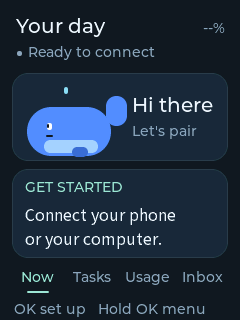
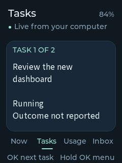
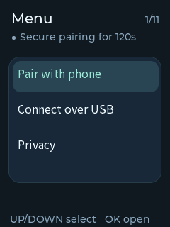

**English** · [简体中文](implementation-status.zh_CN.md)

# Agent Pet Implementation Checkpoint

Status: active implementation, not a finished or hardware-accepted release. This records the accepted scope and integration state for continued work. [Product design](agent-pet-design.md) and [mobile/remote design](mobile-remote.md) remain requirements; this page distinguishes implementation evidence from plans.

## Bring-up verification of the live data path

To verify the USB data path without a physical button sequence, a **temporary bring-up image** opened the setup window once at boot (same code as the menu, no other change). It was built from the same sources, flashed to `0x10000`, used, and then replaced by the archived release image; the source tree was restored byte-for-byte (SHA-256 `b5aa5577…` before and after).

Against the running bridge with the live Magpie source, one session forwarded 45 frames and the device reported:

| Field | Value |
| --- | --- |
| `task_count` | 15 real tasks |
| `source_fresh` | true |
| `applied_revision` | 3 |
| `synchronizing` | false |
| `heap_free` after streaming | 63,152 B |
| largest block | 49,152 B |
| `allocation_failures` | 0 |
| `stack_min_free` during streaming | 6,256 B |

This proves the chain from the live source through the bridge, WSS, host forwarder, USB framing and the firmware model into the UI state. It does **not** prove the physical menu sequence on the shipped image, and it does not prove what the panel looks like; those remain open.

## Open blockers

Four things still prevent a complete acceptance, and each needs a decision or a physical action rather than more code:

1. **The shipped build has never had its window opened by the buttons.** The data path itself is now proven (see the bring-up section), but the menu-driven `OK` sequence on the released image is still unexercised.
2. **The device has no Wi-Fi credentials.** Provisioning needs the network password, which only you can supply; the bridge is also loopback-only today, so a LAN profile must be activated deliberately before a device could reach it.
3. **`open_on_host` is currently unavailable** because the owner browser client is not attached with a navigation lease. The device correctly reports the action as unavailable instead of pretending.
4. **No public deployment exists.** The relay, enrollment and revocation code is tested locally, but no internet-facing service was deployed and none is claimed.

## Accepted scope

- Original whale companion UI, task/attention/usage/inbox views, private/public modes and three physical buttons.
- Real Magpie source integration, bounded state synchronization, verifiable usage without invented billing or task success.
- Secure local networking, USB recovery, phone BLE provisioning and enrollment, optional remote relay and phone views.
- Device testing authorized by the user. Identify exact artifacts and data impact before writing; preserve unrelated data and do not erase the chip.
- No commits, pushes, public deployment, or global configuration replacement are implied.

## Current implementation

| Component | Evidence | Pending acceptance |
| --- | --- | --- |
| Firmware model | Bounded C JSON parsing, atomic snapshots/deltas, sequence/epoch recovery, orthogonal running/waiting; pure tests and sanitizer checks | Physical operation against live data |
| Original UI | New LVGL whale, four pages, menu, pairing QR and Chinese font linked once; full 240x320 frame confirmed on the board | Longer interaction/typography pass |
| Device networking | Wi-Fi, certificate-verified WSS, USB setup with physical confirmation, trial configuration/rollback | Real Wi-Fi/BLE/TLS operation and resource peaks |
| Phone provisioning | Maintained ESP-IDF Security1 transport, fresh PoP, persistent P256 identity, signed enrollment, asynchronous custom endpoint | Native app and real BLE interoperability |
| Trusted time | Bounded nonce-bound P256 signed time verification before ordinary TLS verification | Cold boot and failure tests on hardware |
| Bridge/relay | Scoped credentials, TLS/WSS, per-view streams, minimal remote cache, enrollment, source freshness, revocation, authenticated relay welcome | Actual cross-network deployment |
| Magpie adapter | Installed 0.2.1 in the live profile; real session/turn/usage events reached the bridge over authenticated IPC | Approving host navigation in the real browser session |
| Mobile | Native iOS Debug/Release simulator builds and Android arm64 release build pass; 26 client tests, type checks and bundles pass | Real phone BLE provisioning and enrolment |
| Chinese font | Licensed static GB2312/ASCII font compiled and linked; glyph coverage checked offline | On-board Chinese text and unsupported-glyph review |

## Device interface refresh

The whale body is now 84 × 49 pixels (previously 128 × 75), with its tail contained in a transparent parent rather than clipped or rotated. Compact rounded cards give task information more space, and a fixed Now / Tasks / Usage / Inbox strip shows the current page.

- UP/DOWN changes pages outside menus and selects rows inside menus.
- OK on Now opens the highlighted task, or the setup menu when no task has arrived.
- OK on Tasks cycles received tasks; with a single task it opens the host-action dialog directly. Usage toggles source details, and Inbox cycles entries.
- Hold OK opens the menu or goes back from a dialog. Destructive settings default to Cancel and require an explicit confirmation.
- Phone pairing changes its hint after physical confirmation. Closing an already dispatched host request does not claim to cancel it; its receipt remains available.

The refreshed interface was application-only flashed to `0x10000` from archive `4bd42fde2b697cb910d82dec69c3a59bf5714069dcf6a494b7f9bb762823eb0f` (2,386,464 bytes). Board replies matched ELF `b19c8df523663ce7948d0431c3ec28904f927ee9c247b59f859ecf31e5d55879`. First-render completion reported 31 objects and no allocation failure; a 300-second idle soak (59 bounded replies, one reset from opening the port) kept free heap between 62,152 and 68,444 bytes with a 49,152-byte largest block, zero allocation failures and no panic, and reported a single ELF image throughout. Only the factory application range was written; NVS, PHY data, the existing data partition and recovery were untouched. This is startup/render evidence, not BLE/TLS peak or user visual acceptance.

At the time of writing, the running bridge held eight tasks published by the live Magpie source (source seen five seconds earlier), with matching identities. None advertised `open_on_host`: that capability requires the owner browser client to attach and hold a navigation lease, so the device correctly reports the action as unavailable rather than pretending it can open a session.

### USB provisioning payload

The USB setup message can carry a full profile: transport, Wi-Fi SSID and key, WSS endpoint, device credential, CA, server name, signed-time URL, issuer, enrollment key and a UTC timestamp. A host builder now produces that exact JSON, and a host test feeds the generated bytes into the firmware's own `pet_config_parse_setup` to prove both sides agree; the payload is 632 bytes in the fixture and about 1.5 KB with a real certificate, well under the 4096-byte frame limit. A `preflight` command reports the payload size and flags an endpoint the device cannot reach.

A LAN profile is prepared but **not active**: `tools/agent_pet_lan_check.mjs` verifies a candidate configuration without binding anything, checking that the bind address is a current local interface, that the certificate covers both that address and the server name, that the key matches, and that the WSS endpoint and signed-time URL point at the same host. The prepared profile passes those checks for the current DHCP address; activating it means the bridge starts listening on the local network, which is left as an explicit decision. Because the address comes from DHCP, the check must be re-run after a network change. Activating it is two explicit steps — stop the current bridge, then start it with the LAN profile — so nothing listens on the network until that command is run:

```bash
node tools/agent_pet_lan_check.mjs .agent-pet/lan/config.json
# then, after stopping the current loopback bridge:
node services/src/cli.mjs .agent-pet/lan/config.json
```

Sending it is deliberately not automated yet: the current loopback endpoint cannot be reached by a device. Wi-Fi provisioning therefore needs the bridge bound to a LAN address with a certificate covering that address, which also exposes the service on the local network and is left for an explicit decision.

A cross-language regression now closes the loop between firmware bytes and the real bridge: the firmware tool emits the exact `action.prepare`, `action` and `action.query` frames it builds, a C test asserts `pet_action_compose` still reproduces them, and a service test feeds those frames into a running bridge over TLS. The bridge returned a real offer, accepted the execute frame, reported `accepted` then `succeeded` after a simulated host confirmation, and answered the status query. Field names, revisions and the token hand-off therefore agree across the two languages.

### Host action (open on computer)

The action path is implemented but not yet accepted on hardware. A local private link offers `open_on_host` only for a fresh task that advertises the capability; the device sends `action.prepare`, shows a Cancel-by-default confirmation, then sends `action` with the offered token and an approved `action_id`. Only a `succeeded` result is labelled "Opened on computer". An accepted request cannot be cancelled from the device, so closing the dialog keeps the receipt and the query reuses the same action ID instead of dispatching again. The USB forwarder relays these commands over the already authenticated connection and still refuses any new credential from the device.

Reproduce them (host-only; needs CMake, make and a C compiler; about a minute):

```bash
python3 tools/ui_preview/generate.py
cmake -S tools/ui_preview -B tools/ui_preview/build   # add -DCMAKE_C_COMPILER=<clang> if none is found
cmake --build tools/ui_preview/build -j 6
tools/ui_preview/build/ui-preview --smoke      # real input() interaction checks
tools/ui_preview/build/ui-preview "$PWD/tools/ui_preview"
python3 tools/ui_preview/convert.py
```

These are actual host LVGL renders, not photographs of the board. Tasks, Usage and Inbox use labelled synthetic fixtures. Board rendering and resource readings are reported separately.







## Device and data preservation

Read-only discovery confirmed an ESP32-C3 revision 1.1, 8 MB Flash, connected through native USB JTAG/serial.

The board partition table differs from the upstream minimal template. A read of only the 4 KB partition table found:

| Partition | Offset | Size |
| --- | --- | --- |
| NVS | `0x9000` | `0x6000` |
| PHY | `0xF000` | `0x1000` |
| Factory app | `0x10000` | `0x300000` |
| Existing data | `0x356000` | `0x4000` |
| Recovery app | `0x700000` | `0x100000` |

[Device-compatible layout](../../partitions.agent-pet.csv) preserves these ranges and the verified table is byte-identical to the one read from the device. The [upstream minimal template](../../partitions.csv) remains available.

Application images have so far been written only to the existing factory offset `0x10000`. The flasher did not write NVS, the existing data partition or the recovery region; no full-chip erase was performed. The application stores its own settings in the existing NVS namespace. The existing data partition contents were not read. No full-firmware backup is required or claimed.

## Validation evidence

- The complete gate passes: static checks, host tests and a real ESP-IDF build with a verified merged image and debug archive.
- Real bridge/relay TLS, authentication, enrollment, relay welcome and WSS tests pass in the service workspace.
- Cross-language tests send actual Node publication frames into the real C model, including 16 tasks, Chinese text, running plus pending questions, decreasing usage corrections and public filtering.
- Adapter tests include actual packaged DSH reducers and a separate Cordis activation/unload smoke; the reviewed 0.2.1 package is installed and returns real state.
- Mobile client tests/type checks/production bundles pass, and native iOS plus Android release builds link the official ESP provisioning SDKs.

## Board findings fixed during bring-up

- First bring-up drew only the upper half of the panel and then starved the idle task. A matched-ELF backtrace placed the hang in the LVGL software transform assertion: the rotated decoration needed an extra ARGB layer and doomed a 24 KB pool. The rotation was replaced with plain shapes and the UI now reports memory; a full frame renders with no watchdog.
- On this macOS/C3 combination, opening the USB serial port was observed to reset the device once even with DTR/RTS pre-set low. Tools therefore hold one handle for a whole session and wait for the physical setup window instead of reconnecting into it.
- Key input was misreported as "UP/DOWN do nothing". A single-session watch proved the buttons and page cycling work; the modal scroll state was swallowing UP/DOWN afterwards. That modal state has been removed and regression-tested. A held-handle USB session delivered 63 frames and the board confirmed fresh source state; real task rendering remains a separate check.

Build: PASS. Host tests: PASS. Device tests: partial — full-frame rendering, a 150-second idle heap observation, buttons through a serial watch and data-preserving application flashes are verified; Wi-Fi, BLE provisioning, phone enrolment, host action and power are not. Unverified: real task rendering, phone provisioning, host navigation in a browser, remote relay over the internet, audio, and long-run memory/power behaviour.
