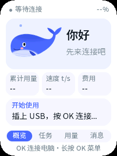
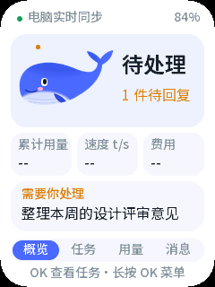
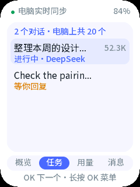
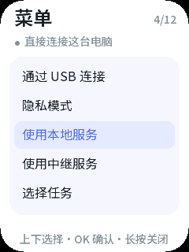
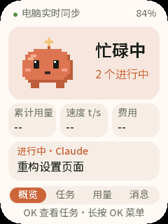
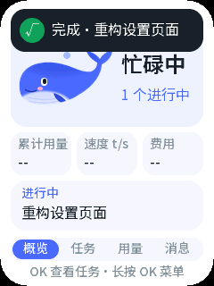

[English](implementation-status.md) · **简体中文**

# Agent Pet 实现检查点

状态：正在实现，尚未形成完成真机验收的发布版本。本文记录已接受范围与集成状态，供持续推进。[产品方案](agent-pet-design.zh_CN.md)和[手机/远程方案](mobile-remote.zh_CN.md)仍为需求依据；本文区分已有实现证据与计划。

## 真实数据链路的上板验证

为了在不需要按键的情况下验证 USB 数据链路，构建了一个**临时上板镜像**：开机时自动打开一次配置窗口（复用菜单里的同一段代码，其余不变）。它由同一份源码构建、刷入 `0x10000`、完成验证后被归档正式镜像替换；源码已逐字节还原（前后 SHA-256 均为 `b5aa5577…`）。

对接运行中的桥接与真实 Magpie 来源，一次会话转发了 45 帧，设备回读为：

| 字段 | 数值 |
| --- | --- |
| `task_count` | 15 个真实任务 |
| `source_fresh` | true |
| `applied_revision` | 3 |
| `synchronizing` | false |
| 传输后 `heap_free` | 63,152 B |
| 最大连续块 | 49,152 B |
| `allocation_failures` | 0 |
| 传输期间 `stack_min_free` | 6,256 B |

这证明了从真实来源经桥接、WSS、主机转发、USB 分帧、固件模型一直到界面状态的整条链路。它**不**证明正式镜像上的物理菜单按键序列，也**不**证明屏幕实际观感；这两项仍未完成。

## 当前阻塞

还有四件事需要决定或物理操作，而不是继续写代码：

1. **正式镜像还没有用按键打开过配置窗口。** 数据链路本身已在上面证明，但发布镜像上的菜单 `OK` 序列仍未实操。
2. **设备还没有 Wi‑Fi 凭证。** 配网需要你提供网络密码；桥接目前也只监听回环，必须先有意启用局域网配置，设备才可能连上。
3. **`open_on_host` 现在不可用**，因为浏览器端所有者客户端没有接入并持有导航租约。设备会如实显示不可用，而不是假装成功。
4. **没有公网部署。** 中继、登记与撤销代码只在本地测过，没有部署任何面向互联网的服务，也不作此声明。

## 已接受范围

- 原创鲸鱼搭子界面，任务/待处理/用量/收件箱，公开与私人模式及三键操作。
- 真实 Magpie 来源，受限状态同步与可核实用量，不虚构费用或目标成功。
- 安全本地联网、USB 恢复、手机 BLE 配网与登记、可选远程中继和手机查看。
- 用户已授权设备调试。写入前明确实际镜像与数据影响；保留无关数据，不全片擦除。
- 不因此默认提交、推送、部署公网或替换全局配置。

## 当前实现

| 组件 | 已有证据 | 待验收 |
| --- | --- | --- |
| 固件模型 | 有界 C JSON、原子快照/增量、序号/隐私代际恢复、运行与等待正交；纯逻辑及 sanitizer 检查 | 真实数据下的真机运行 |
| 原创界面 | 全新 LVGL 鲸鱼、四页、菜单、配对二维码与中文字体；240x320 整屏画面已真机确认 | 更长时间的交互与排版复查 |
| 设备通信 | Wi-Fi、证书校验 WSS、物理确认 USB 配置、候选配置与回退 | 真实 Wi-Fi/BLE/TLS 与峰值内存 |
| 手机配网 | ESP-IDF Security1、临时 PoP、持久化 P256 身份、签名登记、异步自定义端点 | 原生 App 与实机 BLE 互通 |
| 可信时间 | 普通 TLS 校验前，验证有界随机 nonce 绑定的 P256 签名时间 | 真机冷启动及异常场景 |
| 桥接/中继 | 权限凭证、TLS/WSS、独立视图流、最小远程缓存、登记、新鲜度与撤销、带鉴权 welcome 的中继 | 实际跨网部署 |
| Magpie 适配器 | 0.2.1 已安装到当前用户配置；真实会话/回合/用量事件经鉴权 IPC 送达桥接 | 在真实浏览器会话中确认宿主跳转 |
| 手机端 | iOS Debug/Release 模拟器构建与 Android arm64 Release 构建均通过；26 项客户端测试、类型检查与打包通过 | 真实手机 BLE 配网与登记 |
| 中文字体 | 有许可的 GB2312/ASCII 静态字体已编译链接并完成离线覆盖检查 | 实机中文与未覆盖字符复查 |

## 设备界面更新

鲸鱼主体由 128 × 75 缩至 84 × 49 像素，尾巴完整放入透明容器，避免裁切和旋转图层。紧凑圆角卡片给任务信息留出更多空间，固定的 Now / Tasks / Usage / Inbox 导航条显示当前页面。

- 菜单外 UP/DOWN 换页，菜单内 UP/DOWN 选择行。
- 首页 OK 打开当前突出显示的任务；尚无任务时进入设置菜单。
- Tasks 页 OK 切换已收到的任务；只有一个任务时直接进入宿主操作对话框。Usage 页切换来源详情，Inbox 页切换条目。
- 长按 OK 打开菜单或从弹窗返回。破坏性设置默认取消，必须明确确认。
- 手机配对在物理确认后更新提示。关闭已经发送的宿主请求不冒充取消操作，其回执仍可查询。

本次界面已从归档 `4bd42fde2b697cb910d82dec69c3a59bf5714069dcf6a494b7f9bb762823eb0f` 仅刷入 `0x10000` 应用区，大小 2,386,464 字节。板卡回读与 ELF `b19c8df523663ce7948d0431c3ec28904f927ee9c247b59f859ecf31e5d55879` 一致。首帧完成时有 31 个对象，且未见分配失败；300 秒空闲浸泡（59 次有界回复，打开串口带来的 1 次复位）期间可用堆保持在 62,152 至 68,444 字节之间，最大连续块 49,152 字节，分配失败 0，未出现 panic，全程只有一个 ELF 镜像。仅写入 factory 应用区，NVS、PHY 数据、既有数据区和 recovery 未被改动。这是启动和渲染证据，不代表 BLE/TLS 峰值或用户视觉验收。

撰写本文时，运行中的桥接服务保有真实 Magpie 来源发布的 8 个任务（来源在 5 秒内仍有更新），身份数据一致。这些任务都没有声明 `open_on_host`：该能力需要浏览器端所有者客户端接入并持有导航租约，因此设备会如实显示“不可用”，而不是假装能打开会话。

### USB 配置载荷

USB setup 消息可以携带完整配置：传输方式、Wi‑Fi SSID 与密钥、WSS 端点、设备凭证、CA、服务器名、签名时间地址、签发者、登记公钥与 UTC 时间。现在由主机端生成这段 JSON，并有主机测试把生成的字节直接交给固件的 `pet_config_parse_setup` 解析，证明两端一致；测试载荷 632 字节，带真实证书约 1.5 KB，远低于 4096 字节上限。`preflight` 命令会报告载荷大小，并标记设备无法访问的端点。

局域网配置已准备但**尚未启用**：`tools/agent_pet_lan_check.mjs` 在不绑定端口的前提下校验候选配置——绑定地址必须是当前本机接口、证书必须覆盖该地址与服务器名、私钥与证书匹配、WSS 端点与签名时间地址指向同一主机。已准备的配置通过上述检查；启用它意味着桥接开始在局域网监听，这一步留作明确决定。地址来自 DHCP，网络变化后需重新运行检查。启用只有两步——先停掉当前桥接，再用局域网配置启动；在执行这条命令前，网络中不会监听任何端口：

```bash
node tools/agent_pet_lan_check.mjs .agent-pet/lan/config.json
# 确认通过、并停止当前回环桥接后：
node services/src/cli.mjs .agent-pet/lan/config.json
```

目前刻意没有自动发送：回环端点设备无法访问。因此 Wi‑Fi 配网需要把桥接绑定到局域网地址，并让证书覆盖该地址——这会同时在局域网暴露服务，留待明确决定。

新增一条跨语言回归，把固件字节与真实桥接连起来：固件工具输出它实际构造的 `action.prepare`、`action`、`action.query` 帧，C 测试确认 `pet_action_compose` 仍能逐字重现，服务测试再把这些帧经 TLS 送进真实运行的桥接。桥接给出了真实 offer、接受执行帧、在模拟宿主确认后依次报告 `accepted` 与 `succeeded`，并正确回答状态查询。两端的字段名、修订号与 token 交接由此对齐。

### 宿主操作（在电脑上打开）

该路径已实现，但尚未完成真机验收。只有本地、私人模式且任务新鲜并声明能力时才会提供 `open_on_host`；设备发送 `action.prepare`，显示默认取消的确认，再用收到的 token 和已批准的 `action_id` 发送 `action`。只有 `succeeded` 才显示「已在电脑打开」。已接受的请求无法从设备取消，因此关闭对话框会保留回执，查询时复用同一 action ID 而不会再次派发。USB 转发只在已鉴权的连接上转发这些命令，仍然拒绝设备端提供的任何新凭证。

重新生成（仅主机；需要 CMake、make 与 C 编译器，约一分钟）：

```bash
python3 tools/ui_preview/generate.py
cmake -S tools/ui_preview -B tools/ui_preview/build   # 找不到编译器时加 -DCMAKE_C_COMPILER=<clang>
cmake --build tools/ui_preview/build -j 6
tools/ui_preview/build/ui-preview --smoke      # 用真实 input() 跑交互检查
tools/ui_preview/build/ui-preview "$PWD/tools/ui_preview"
python3 tools/ui_preview/convert.py
```

下面是实际 LVGL 离屏渲染，并非板卡照片，已套用板卡的 30 px 圆角遮罩。实时概览、任务、用量、消息和电脑操作几张图采用标注明确的合成测试数据。真机显示和资源回读另行记录。

页面布局：页面标题由分段标签栏承担，顶部改为细状态栏（连接圆点、状态文字、电量）；内容区占 y 38-260；当前标签用滑动的实心胶囊标出，底部一行说明按键。概览由宠物卡片、今日三项数据卡（用量、速度、费用）和最重要的一项任务组成。任务和消息是四行列表，选中行高亮（按 OK 移动）；用量页在同样的数据卡下方列出三行一页的按模型明细。菜单和对话框保留原来的标题式布局。

屏幕文案全部为简体中文。固定文案用两套从 UI 源码生成的子集字库绘制（`pet_font_ui_14` 用于状态行、标签栏和按键提示，`pet_font_ui_24` 用于标题和大数字），动态任务文字仍用 GB2312 的 `pet_font_cjk_16`。运行时状态在日志里保持英文，由 `main/agent_pet_text.c` 翻译；若某条运行时状态缺少中文，或某个界面字符缺少字形，`tests/test_agent_pet_text_coverage.py` 会失败。









菜单中的“主题”可在两套原创外观间切换，并保存在 NVS：白底蓝色鲸鱼位图（`tools/agent_pet_whale.py`）和暖白底橙色像素小怪（`tools/agent_pet_critter.py`）。两者都不复制任何厂商的标志或吉祥物。切换时在 LVGL 锁内重建一次界面。




### 桌面模式与宠物行为

在概览页 20 秒没有按键后，设备进入桌面模式：2 倍大的宠物、用 40 px 数字字体像里程表一样滚动的今日 token、实时生成速度和费用、滚动显示的当前任务，以及最近 30 分钟输出 token 柱状图（`usage.spark`，来自 Magpie 的逐请求时间）。任意键返回概览，不触发其他操作。宠物情绪来自纯 C 的 `main/agent_pet_mood.c`（有主机测试）：空闲时慢慢呼吸；有任务运行时动得更快，并按 token/s 冒出气泡或火花；任务等你回复时跳动的“!”；运行中的任务停止时撒一把彩纸。任务完成和需要回复会从顶部滑下横幅。粒子和柱状图各由一个自绘对象完成，按粒子局部刷新，25 fps；真机上包含桌面模式的 60 秒观察中，空闲堆最低 43.6 KB（最大连续块 34.8 KB），没有分配失败。




## 设备与数据保留

只读探测确认为 ESP32-C3 revision 1.1、8 MB Flash，通过原生 USB JTAG/串口连接。

板卡分区表与上游最小模板不同。仅读取 4 KB 分区表得到：

| 分区 | 偏移 | 大小 |
| --- | --- | --- |
| NVS | `0x9000` | `0x6000` |
| PHY | `0xF000` | `0x1000` |
| Factory 应用 | `0x10000` | `0x300000` |
| 既有数据区 | `0x356000` | `0x4000` |
| Recovery 应用 | `0x700000` | `0x100000` |

[设备兼容布局](../../partitions.agent-pet.csv)保留这些区间，且生成的分区表与从设备读出的内容逐字节一致。[上游最小模板](../../partitions.csv)仍然保留。

目前只把应用镜像写入既有 factory 偏移 `0x10000`。刷写工具没有写入 NVS、既有数据分区或 recovery 区，也未执行全片擦除；应用会在现有 NVS 中保存自己的设置。既有数据分区内容未读取。不要求或宣称已备份整片固件。

## 验证证据

- 完整检查通过：静态检查、主机测试，以及真实 ESP-IDF 构建和已校验的合并镜像与调试归档。
- 服务目录下真实桥接/中继的 TLS、鉴权、登记、中继 welcome 与 WSS 测试通过。
- 跨语言测试把真实 Node 发布帧送入真实 C 模型，覆盖 16 个任务、中文、运行中且有待回答问题、用量下修与公开过滤。
- 适配器测试使用真实打包 DSH 归约器与独立 Cordis 启停 smoke；已审阅的 0.2.1 包已安装并返回真实状态。
- 手机客户端测试、类型检查与生产打包通过；iOS 与 Android Release 原生构建均成功链接官方 ESP 配网 SDK。

## 联调中发现并修复的问题

- 首次上电只画出上半屏随后饿死空闲任务。按已刷入 ELF 符号化后定位到 LVGL 软件变换断言：旋转装饰需要额外 ARGB 图层，撑爆 24 KB 内存池。改为普通形状并输出内存遥测后，整屏可正常绘制且无看门狗。
- 在这台 macOS/C3 组合上，即便预设 DTR/RTS 为低，仍观察到打开 USB 串口会复位一次。工具改为整个会话只持有一个句柄，并等待物理窗口打开，而不是反复重连。
- 曾误判“上下键无效”。单会话观察证明按键与翻页正常，问题在于随后的模态滚动状态吞掉了上下键；该状态已移除并通过回归测试。保持同一串口句柄的会话成功发送 63 帧，板卡确认来源新鲜；真实任务显示仍须独立验证。

构建：PASS。主机测试：PASS。真机测试：部分——整屏渲染、150 秒空闲内存观察、按键串口观察与保数据应用刷写已验证；Wi-Fi、BLE 配网、手机登记、宿主操作与功耗未验证。未验证：真实任务显示、手机配网、浏览器宿主跳转、公网中继、音频与长期内存/功耗表现。
