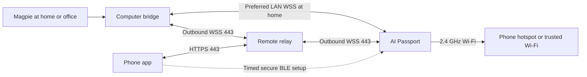

**English** · [简体中文](mobile-remote.zh_CN.md)

# Phone Provisioning and Remote Use

Status: included in Agent Pet scope, not implemented. This supplements the [main design](agent-pet-design.md) with travel without a computer, phone-only setup, cross-network synchronization, and remote-control limits. Phone provisioning and remote read-only status are P1 deliverables, accepted as P1a local and P1b mobile/remote. Supported write operations remain P2. P0 validates secure BLE provisioning, Wi-Fi/TLS coexistence, and remote cold boot before resource constraints become late surprises.

## 1. Scenarios and network paths

| Scenario | Path and experience |
| --- | --- |
| Home, computer online | Prefer direct LAN; cloud remains optional |
| Away, computer online at home | Device joins a 2.4 GHz phone hotspot/trusted Wi-Fi and receives relay updates |
| Phone/device online, computer asleep/offline | Show timestamped last snapshot; relay cannot generate new local-task events |
| Agents hosted on a server | Run an authorized adapter/bridge there after verifying interfaces; personal computer can be unnecessary |
| No Wi-Fi/hotspot | Local pet/pages/actions remain; offline indication, no cellular hardware |
| Phone app closed | Device reaches relay directly while hotspot remains available; no continuous app BLE gateway required |
| First use with phone only | Scan device screen, physically confirm, configure network, enroll account, select authorized source; no source means not connected |

Hotspot must offer 2.4 GHz. Opening hotspot or reading its network credentials programmatically varies by OS and is not promised. Guide users through system settings and manual credentials. The phone need not join its own hotspot as a Wi-Fi client. Distinguish BLE connected, DHCP obtained, Internet reachable, relay authenticated, and source online.

## 2. Phone client and responsibilities

Choose a companion app with native iOS/Android BLE, potentially a cross-platform framework with native modules; use the system browser for login. A webpage/PWA may offer remote viewing but is not a universal BLE onboarding solution across iOS/Android. Validate WeChat tooling separately.

The app provides:

- Account login, device-QR scan, device list, and authorized computer/server sources.
- BLE setup/network changes, diagnostics, remote-mode control, revocation, and public-mode management.
- Tasks, usage, and update times; detailed links only where a supported mobile/host page exists.
- Hotspot setup instructions, traffic, source health, and relay health.
- P2 explicit answers/operations when host APIs permit, still authorized and expired by the source.

Do not automatically read saved system Wi-Fi passwords, require router-admin permissions, or trust BLE names as identity. Native notifications are optional, requiring permission and actual APNs/FCM or another supported delivery channel. Long connections/web notifications do not guarantee background delivery. Lock-screen text defaults to a generic attention alert, hiding projects/spending.

Use the upstream provisioning mini program's exact name from the [Chinese reference](../development/engineering/wifi-provisioning.zh_CN.md#mini-program-name). It can validate/reference BLUFI network setup, not this product's account enrollment, ownership, source trust, or relay. The new app does not promise the same protocol. An ESP-IDF-maintained secure provisioning transport requires separate verification of phone SDKs, ESP32-C3, ESP-IDF 5.5.3, and memory. Copying one provisioning file is insufficient.

## 3. Phone-only enrollment and ownership

1. First boot or the phone-setup menu opens a 120-second BLE window. Pause optional animation/audio and close BLE on expiry.
2. Generate a temporary high-entropy pairing secret and session nonce, displaying a QR with temporary information/device public-key fingerprint. This is a firmware-generated screen code, not the existing printed product QR, which must not be assumed to contain provisioning keys.
3. Use a maintained secure provisioning/proof-of-possession protocol with the scanned secret to authenticate and encrypt BLE configuration, followed by physical OK. Short comparison codes are not the sole cryptographic secret. Do not invent key exchange. Protocol/phone-library compatibility is a P0 gate; USB recovery remains if infeasible, and mobile setup is not complete until verified.
4. Logged-in app requests a short-lived one-use enrollment ticket binding account, device public key, current nonce, purpose, and target service. Device verifies the pretrusted service signature/nonce; server atomically consumes the ticket and rejects cross-account/replay attempts. Before trusted device time, use the live-session window, nonce, and server consumption rather than device wall clock alone.
5. Authenticated BLE transfers Wi-Fi, endpoint/trust configuration, and enrollment ticket. Device generates/retains its private key and proves public-key ownership for enrollment. Never deliver computer credentials, provider keys, or account passwords. Users may configure local Wi-Fi without enabling a remote account.
6. Obtain IP, recover trusted time, authenticate relay TLS/device identity, validate enrollment, and choose an authorized computer/server source. Show each stage and recovery steps separately.
7. Close BLE on completion/exit. Persist network credentials only where needed on device; app does not additionally retain them by default or log them.

Production firmware must carry the selected service's verification public key/root trust. Import self-hosted domain/trust explicitly over paired USB or an authenticated phone session; discovery/QR URLs cannot install arbitrary trust. Service, app, and signing-key management are actual deliverables, not assumed existing cloud infrastructure.

Preserve USB pairing: after physical confirmation, enroll a phone controller over an existing trusted path or a new secure BLE session without clearing networks/computer trust. Account login alone does not authorize overwriting an unconfirmed device's trust.

Reconfiguration requires an enrolled controller's authorization or explicit physical transfer/reset. Network changes do not change account/computer identity. Revoke a lost phone session or lost-device credentials independently. Factory reset/ownership transfer follows physical confirmation; the initial product does not prevent physical erasure/reflashing by someone holding the device.

## 4. Network changes and recovery

Remember up to three networks and autojoin only authorized entries. Starting a saved phone hotspot should reconnect automatically. New environments can be configured during an app BLE window without contacting the home computer.

Test candidate configuration before replacing a persistent slot: obtain IP and validate the chosen path. With three stored networks, ask which to replace rather than silently removing home Wi-Fi. Wrong credentials/timeouts preserve old settings. Distinguish Wi-Fi connected, no Internet, relay unreachable, source offline, and allow fallback or a LAN-only network.

Captive portals, enterprise 802.1X, and 5 GHz-only networks remain unsupported automatically. Guest isolation may block LAN while public relay access works; LAN failure is not proof of wrong Wi-Fi credentials. If hotspot or cellular data is unavailable, go offline and back off without fast battery-draining loops.

P1 does not depend on continuous BLE gatewaying. A future device-to-phone-to-relay path needs independent validation of OS background limits, process termination, recovery, permissions, power, and ordering; it is not an existing seamless hotspot fallback.

## 5. Relay, authorization, and data boundaries

Bridge and device initiate outbound relay connections on `443`, traversing NAT without opening a public port on the home computer. Computer management stays loopback and LAN service stays on the chosen private interface. Account APIs and bridge/device WSS validate real certificates. DNS/certificate failures never downgrade task communication to plaintext.

Separate account, controller, source bridge, and device identities with scoped credentials. Bridges publish only authorized sources; devices subscribe only to bound views and request allowed operations; phone controllers manage through account authorization. Room IDs, names, and invite QR codes are not authorization. Validate account/source/device relationships at enrollment/subscription/action time. Revoked credentials cannot reconnect. Rate-limit and audit login/enrollment.

Relay is not a generic proxy for terminals, files, host HTTP, or raw Magpie APIs. Default remote allowlist: task IDs/aliases, state, attention counts, verifiable usage totals, source timestamps. Real names, question text, and money require explicit enablement. Continue excluding raw code, conversations, tool output, and provider secrets.

First remote version uses **TLS on both legs to the relay**. The relay is a trusted processor and may read permitted summaries; do not call this end-to-end encryption. Before enabling, disclose fields, region, retention, operator, and self-hosting option. Evaluate mature E2EE protocols, recovery/multidevice keys, and C3 resources separately. Disabling remote leaves LAN working.

Keep only the latest complete minimal snapshot per authorized view and health metadata, default snapshot TTL 24 hours. Do not replicate computer-side seven-day task history/30-day aggregates. Remote action intent/results and audit metadata default to at most seven days, clearable by the user. Today's aggregate inside a snapshot is not full cloud history. Revoke/disable/delete removes related snapshots/subscriptions and stops refresh. Publish backup-deletion timelines rather than promising immediate erasure of every backup.

Management also needs account recovery, device inventory/revocation, certificate/signing-key rotation, encrypted storage, request/concurrency/traffic quotas, monitoring, and deletion. No relay is deployed yet. Define domain, hosting region, and cost before deployment; unlimited free relay is not assumed.

## 6. Transport switching, caching, and freshness

Initially select one source bridge, preventing accidental merging across computers. Relay preserves source semantics and the main design's snapshots, view_epoch, per-device stream/revision, deduplication, and action IDs.

LAN and remote may use different field allowlists; filter at the computer before assigning revisions. Publication view identity includes device, privacy epoch, and transport policy. Remote gets its own stream; never upload the full private LAN view for cloud filtering. Switching starts from that path's snapshot, never applies LAN revisions to a different remote view. Relay only caches/forwards the already-filtered view and does not invent business sequence numbers or change semantics.

Prefer authenticated reachable LAN, then remote, then offline. Stop the old transport before remote connect. Switch back after 30 seconds of stable LAN probing and at least a 60-second switching cooldown. Keep only one business TLS connection on the device. Use bounded lightweight/last-address probes rather than a second full TLS handshake alongside remote; temporary synchronizing state is acceptable.

Switching negotiates a fresh transport-session ID/full snapshot. Old-channel callbacks/actions/alerts cannot update the new channel. Source publication stream may persist, but relay resumes only from its real snapshot baseline. Missing continuity requires a new bridge snapshot, never skipped revisions. Do not count tokens or notify twice across LAN/remote.

Publish cached snapshots atomically only after complete validation; serve one before subsequent deltas. Relay restart without continuity or a missing privacy view waits for source resynchronization, never assembles stale/missing pages into apparent current state. Distinguish relay, device, bridge, and Magpie-source health.

Use 15-second source heartbeat/45-second stale threshold; relay heartbeats never refresh `source_updated_at`. Include origin ID, stream/revision, view_epoch, source time, relay receive time, and source health. Cached source expiry shows computer offline/last sync and disables remote actions. A 24-hour storage TTL is not a freshness lifetime.

Public mode immediately applies on device and forwards new view_epoch to relay/bridge. Drop old queues/cache and await the matching filtered snapshot. If the bridge is offline, show generic pet/offline state instead of replaying private cache. Reject old epochs; private mode requires physical confirmation/new snapshot. Logout/revocation prevents cached views being reused after enrollment into another account.

## 7. Remote cold-boot time and credentials

Outside LAN, home `7444` time bootstrap is unreachable. Relay offers a minimal signed-time bootstrap using the main design's nonce, fixed encoding, five-second response window, and P-256/SHA-256 verification. Its verification public key must already be in firmware/trusted configuration. A public-time-only HTTP endpoint may bootstrap; then fully verify ordinary HTTPS/WSS certificates. Never send account/device credentials over an unverified channel.

Remote and LAN time use explicit issuer/key IDs and pretrusted key sets, never interchangeable identities. Bad signatures/nonces, interception, or bootstrap failure back off with repair instructions. Allow trusted time from authenticated phone BLE or USB; temporary scanned phone recovery requires physical confirmation, not trust in BLE advertising.

Remote and LAN credentials are independent. Protect limited-scope refresh credentials; access tokens are short-lived and revocable. Rotation does not place provider keys on device. Freeze token lifetime/refresh/account-recovery rules in the service API. Disabling remote closes relay connections and destroys remote credentials while retaining LAN trust unless full unpair is requested.

## 8. Remote operations and phone viewing

P1b is read-only: status, usage, alerts, phone details. Away from home, label `open_on_host` as opening on the computer, never imply it opens that desktop session on the phone. Offer web/mobile details only when a supported page exists.

P2 operations remain validated at the source bridge for capability, user/device authorization, target/request revisions, action token, and expiry. Relay persists intent before forwarding; source deduplicates the same action ID and returns actual outcomes. Relay receipt is not execution success. Do not deliver expired/revoked requests or hold answers/cancels through source outages for execution the next day. Unknown outcomes stay unknown and are queryable.

If phone/device answer simultaneously, source atomically accepts the first valid answer; later attempts conflict and resynchronize. Approvals, deployments, publishing, payments, and credentials stay in host flows with full context. Mobile approvals require a separately supported full review interface, never a small-screen shortcut around review.

## 9. Resources, traffic, and acceptance

Enable BLE only for setup; release it before business TLS to reduce peak memory. Measure BLE/Wi-Fi connection, post-BLE TLS, failures/retries, and teardown. Pause optional pet activity if needed while retaining buttons/recovery.

Do not send token streams remotely. Coalesce ordinary state to at most once per five seconds, attention/terminal updates as soon as practical. Initially retain 15-second heartbeat, adjusting only with measured traffic/hotspot/power behavior and matching stale thresholds. Traffic includes TLS/TCP/reconnects and phone requests, not just JSON. Track upload/download and optional traffic alerts; promise neither unlimited data nor all-day hotspot life.

| Acceptance group | Required cases |
| --- | --- |
| Phone setup | iOS/Android permissions, scan, wrong device/code, timeout/reject, no-computer first use, USB recovery, repeated entry/exit |
| Ownership/network | Replayed/cross-account tickets, revoked phone, three-network replacement, wrong credentials preserving old networks, own hotspot, 5 GHz/no-cellular/hotspot off |
| Relay | Different networks/carrier NAT, blocked 443, relay restart/outage, reconnect, LAN/remote switching without duplicated usage/alerts |
| Cold boot | Power cycle outside LAN, valid/forged/replayed/timed-out time response, expired/rotated certs, phone time repair |
| Freshness | Computer sleep, relay still online, plugin-only disconnect, 45-second/24-hour aging, sources without replay |
| Privacy/revocation | Account isolation, lost-device revoke, in-flight old frames, public mode offline, cloud deletion, no cross-account cached view |
| P2 operations | Token expiry, simultaneous answers, relay ACK versus host outcome, disconnect/crash/reboot never executes old requests |
| Resources/operations | Setup/connection peak heap, repeated retries, hotspot traffic, battery, quotas, key rotation, sanitized diagnostics/deletion |

Targets with source online and stable networks: attention/terminal relay-to-device p95 <=5 seconds, ordinary updates <=10 seconds, source stale visibly within 45 seconds. These are unverified targets affected by cellular signal, OS hotspot behavior, and hosting, not a notification SLA. Record at least 24 hours of mixed LAN/hotspot use and physical power measurements before battery claims.

## 10. Delivery split

- P0: secure phone provisioning SDK, phone-only enrollment tickets, BLE/Wi-Fi/TLS memory, remote time bootstrap feasibility.
- P1a: useful local behavior with USB setup/recovery retained.
- P1b: phone setup/enrollment/network changes, account/relay read-only state, hotspot, transport switching, revocation/privacy; an explicit product deliverable.
- P2: verified remote answers/control, voice, optional phone push.
- P3: other tools, multi-source aggregation, continuous BLE gateway, E2EE, signed OTA, separately validated as needed.

This iteration changes design only: no cloud deployment, account creation, firewall change, personal-data upload, or flashing. Before deployment present the actual service/domain/cost/data policy for user confirmation.
