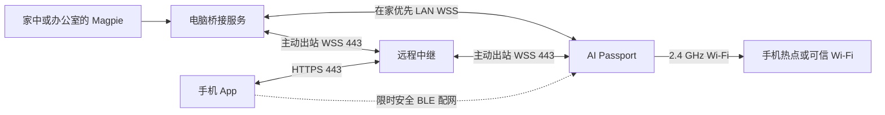

[English](mobile-remote.md) · **简体中文**

# 手机配网与远程使用方案

状态：已纳入 Agent Pet 产品范围，尚未实现。本文补充[主方案](agent-pet-design.zh_CN.md)，覆盖不带电脑出门、手机独立配网、跨网状态同步与远程控制的边界。手机配网和远程只读状态为 P1 的交付项，分 P1a 本地、P1b 移动远程验收；受支持的可写操作仍在 P2。P0 先验证 BLE 安全配网、Wi-Fi/TLS 共存和远程冷启动，避免到后期才发现资源不足。

## 1. 用户场景与网络路径

| 场景 | 路径与体验 |
| --- | --- |
| 在家且电脑在线 | 设备优先 LAN 直连，不要求启用云服务 |
| 出门，电脑留在家里在线 | 设备连手机 2.4 GHz 热点或可信 Wi-Fi，通过中继更新状态 |
| 手机和设备有网，但电脑睡眠/离线 | 中继提供标注时间的最后快照，不能产生新的本地任务状态 |
| Agent 本来运行在服务器 | 将适配器/桥接部署在对应在线主机，核实其事件接口后可不依赖个人电脑 |
| 没有 Wi-Fi/热点 | 宠物、离线页面和本地操作可用，显示离线；此硬件没有蜂窝网络 |
| 手机 App 被关闭 | 配好热点且热点仍在线时设备可直接连接中继，无需 App 后台 BLE 转发 |
| 只有手机，首次使用 | App 扫设备屏幕码、物理确认、配置 Wi-Fi、登记账户和选择已绑定来源；无来源时仅显示未接入 |

手机热点必须提供 2.4 GHz；手机是否支持应用内打开热点、自动获取 SSID/密码因系统而异，不作承诺。App 给出系统设置指引，允许用户手填热点名称/密码。设备连接手机自身热点时，不要求手机作为 Wi-Fi 客户端再加入自己的热点。蓝牙成功、取得 IP、互联网可达、中继鉴权、来源在线分开展示。

## 2. 手机端形态与职责

选择支持 iOS/Android 原生 BLE 的伴侣 App，可用跨平台框架配原生模块；系统浏览器负责登录。普通网页/PWA 仅作为远程查看页面，不能作为通用 iOS/Android 蓝牙配网方案。微信工具作为兼容路径单独验证。

手机 App 承担：

- 登录账户，扫描设备配对二维码，列出已绑定设备、电脑/服务器来源。
- 蓝牙配网、换网、连接诊断、远程开关、撤销设备与公开模式管理。
- 显示任务、用量与最后更新时间；复杂内容仍跳转到已确认存在的手机/宿主页面。
- 展示手机热点设置指导、数据量、来源在线状态和中继服务状态。
- P2 在宿主接口允许时提交明确的回答/操作；仍由来源端验证权限与时效。

App 不自动读取系统保存的 Wi-Fi 密码，不要求路由器管理权限，不把 BLE 广播名当作身份。原生通知是可选能力，需要用户授权和实际 APNs/FCM 或其他受支持渠道；不把长连或网页通知当作后台必达保证。锁屏通知默认只显示“有任务需要处理”，避免透露项目与费用。

上游配套工具名称为 **蓝牙配网-FoloToy AI PASSPORT**。它可参考/验证 BLUFI 网络配置，不代表已支持本产品的账户登记、设备所有权、可信来源或远程中继。新 App 不承诺与上游小程序共用同一协议；若采用 ESP-IDF 维护的安全 provisioning 传输，需单独核实手机 SDK、ESP32-C3、ESP-IDF 5.5.3 及内存兼容。不能移植一份配网文件就宣称接入完成。

## 3. 首次手机配网与所有权

1. 设备首次开机或用户进入“手机配网”，开启 120 秒 BLE 窗口。暂停非必要动画与音频；窗口超时关闭 BLE。
2. 设备现场生成临时高熵配对秘密与会话 nonce，以二维码展示；手机扫码得到临时信息与设备公钥指纹。二维码不是出厂机身专属码，不能假定现有印刷二维码含有固件配对密钥。
3. App 与设备使用经过维护的安全 provisioning/证明持有协议，结合扫码秘密认证会话、加密 BLE 配置，再由设备按 OK 物理确认。短码只用于比对，不作为唯一加密秘密；不自行发明密钥交换。具体协议/手机库选择为 P0 门槛，兼容性不足则保留 USB 恢复，手机路径不能算完成。
4. App 登录远程服务后请求一次性、短期登记票据，绑定账户、设备公钥、当前 nonce、用途和目标服务。设备验证预置信任的服务签名及 nonce；服务端原子核销票据，拒绝跨账户或重复登记。首次登记前，设备无时间时以会话存活窗口、nonce 和服务器核销判定新鲜度，不仅依赖本地时钟。
5. App 经已认证 BLE 会话发送 Wi-Fi、服务地址/信任资料与登记票据。设备本地产生并保留私钥，远程登记使用公钥证明；不把电脑凭证、模型 key 或账户密码下发给设备。用户也可仅完成本地 Wi-Fi 配置，暂不开通远程账户。
6. 设备取得 IP，恢复可信时间，完成中继 TLS 与设备认证；服务端核对登记状态，选择用户已授权的电脑/服务器来源。App 显示分别通过的阶段，失败时保留明确恢复入口。
7. BLE 在完成/退出后关闭。密码仅保存在设备所需的配置区域；手机默认不额外永久保存 Wi-Fi 密码，诊断日志不记录。

生产固件需预置所选远程服务的签名验证公钥与根信任；自托管域名/信任通过已绑定 USB 或受认证手机会话显式导入，不能信任发现广播或任意扫码网址。预置服务、App 与签名密钥管理是需要实际交付的组件，本文不假设已有运营中的云端。

已有 USB 绑定保留：App 可在设备物理确认后，通过现有可信通道或新的安全 BLE 会话登记为控制端，不必清空旧网络/电脑绑定。手机本身登录账户不自动获得改写未确认设备信任的权限。

已绑定设备再次配置需已登记控制端的授权或设备上的明确“转移/重置”操作。仅修改网络不得改变账户或电脑身份。遗失手机可在账户撤销其会话；遗失设备可撤销该设备凭证。恢复出厂和所有权转移遵循现有物理确认策略；首版不承诺阻止有物理访问的人擦除和重新刷写设备。

## 4. 出门换网与失败恢复

设备记住最多 3 个网络，主动连接已授权列表。用户打开手机热点后，设备应自动重连已保存热点。进入新环境可在 App BLE 配网窗口下发新网络，无需访问家中电脑。

使用候选配置测试：先暂存新 SSID/凭据，验证取得 IP 与所选路径可用，再替换持久化槽位；已有 3 项时由用户选择替换，不静默挤掉家庭网络。错误密码或连接超时不删除旧配置。分别显示“已连 Wi-Fi / 无互联网 / 中继不可达 / 来源离线”，并允许回退旧网络或继续使用只能 LAN 通信的网络。

酒店/咖啡馆需要网页认证、企业 802.1X、仅 5 GHz 网络仍不支持自动接入。访客网络隔离可能阻止 LAN，却仍允许设备访问公网中继；不能把 LAN 不通等同于 Wi-Fi 密码错误。手机热点关闭或手机无蜂窝数据时，设备进入离线并按主方案退避，避免无限高速耗电重试。

P1 不依赖持续 BLE 网关。若以后增加“设备 BLE → 手机 App → 中继”，需分别验证 iOS/Android 后台限制、系统杀进程、蓝牙恢复、权限、耗电和消息顺序，不能将其当作当前热点方案的无缝兜底。

## 5. 中继、认证与数据边界

电脑桥接服务和设备都主动出站连接中继的 `443` 端口，跨 NAT 使用，不开放家中电脑公网端口。电脑管理 API 保持 loopback；LAN 服务仅绑定选定私网。中继的账户 API 与设备/桥接 WSS 均验证正式证书，DNS/证书错误不得降级为明文任务通信。

主体分离为账户、控制端、来源桥接和设备。各自独立凭证、用途与权限：桥接只能发布已授权来源；设备只能订阅绑定视图并请求允许操作；手机控制端通过账户授权管理设备。不把某个账户的 room ID、设备名或邀请二维码当作授权。登记/订阅/动作每次校验账户、来源与设备关联；断开后已撤销凭证不能续接。登录/登记有速率限制与审计记录。

中继不是任意网络代理，不转发终端、文件、宿主 HTTP 或原始 Magpie API。远程默认白名单：任务 ID/别名、状态、待处理数量、可核实汇总用量及来源更新时间；问题正文、项目真实名、费用可在明确开启后增加。原始代码、对话、工具输出和模型密钥保持排除。

首个远程版本采用**双方到中继的 TLS 加密**，中继为受信任的数据处理方，可能读取允许上送的摘要；不宣称端到端加密。开启远程前明确说明字段、存储地点、保留时间和运营方，可选择自托管；端到端内容加密单独评估成熟协议、恢复/多端密钥和 C3 资源后再增加。关闭远程不影响 LAN 使用。

中继仅保存每绑定视图最近一份完整的最小快照及状态元数据，快照默认最长 24 小时；不复制主方案中电脑侧 7 天任务历史/30 天聚合。远程动作意图/结果最多 7 天，审计元数据默认 7 天，均可主动清除。快照中已有的今日聚合不等于云端持有完整历史。撤销设备、停用远程或请求清除时，删除对应快照与订阅并停止刷新；备份清理时限须在运营策略中明确，不承诺即时抹除所有备份。

管理服务还需实现账户恢复、设备清单与撤销、证书/签名密钥轮换、存储加密、请求/并发/流量上限、服务告警和数据删除。远程服务尚未上线；域名、托管地区与成本在实现部署前明确，不把免费无限中继作为产品假设。

## 6. 路径切换、缓存与新鲜度

首版配置一个来源桥接，避免把不同电脑的任务误拼成同一个状态。远程服务不修改来源业务含义；设备沿用主方案分页快照、view_epoch、每设备 stream/revision、去重和动作 ID。

LAN 与远程可采用不同字段白名单，必须在电脑桥接端先过滤再编号。发布视图身份包含设备、隐私 epoch 和路径策略，远程视图使用独立 stream，不能先上传完整私人 LAN 视图再让云端过滤。切换路径始终以该路径的新快照为基准，不能拿 LAN revision 推进不同的远程视图。中继只缓存/转发已过滤视图，不新增业务序号或修改其含义。

路径优先级：可达且已认证的 LAN 优先，远程为备用，均不可达则离线。LAN 失效后先停止旧传输，再连接远程；重回 LAN 需稳定探测 30 秒并经过至少 60 秒切换冷却，避免在信号边缘抖动。设备同时只保留一个业务 TLS 长连。LAN 探测使用有界短探测/上次地址信息，不一边持有远程长连一边开启第二个完整 TLS 握手；切换时允许短暂同步中。

每次切换重新协商传输会话 ID 与完整快照，旧通道回调、动作和通知不能污染新通道。来源 publication stream 可延续，但中继必须按其实际持有的快照基准恢复；缺少连贯增量时请求桥接新快照，不自行跳过 revision。不得在 LAN 和远程各自重新累计 Token 或重复播报。

中继只将完整校验后的快照原子设为可读；新设备连接时先拿完整快照再接后续增量。中继重启丢失增量或隐私视图无匹配快照时，等待来源重新同步，不能把缺页/旧 epoch 数据拼成最新状态。中继在线、设备在线、桥接在线、Magpie 来源在线分层显示。

来源心跳沿用 15 秒/45 秒失效，服务心跳不能更新 `source_updated_at`。远程快照含 origin ID、stream/revision、view_epoch、源时间、中继接收时间和当前来源健康；缓存超过来源有效期时，显示“电脑离线 · 最后同步…”，禁用远程动作。24 小时是存储 TTL，不是实时有效期。

公开模式从设备立即生效，并将新的 view_epoch 传到中继及桥接：丢弃旧队列、旧缓存，等待匹配的过滤快照。桥接离线无法生成公开视图时，只显示通用宠物/离线状态，不回放旧私人快照。设备拒绝旧 epoch；回到私人模式需物理确认与新快照。远程注销或撤销后，旧缓存不能在重新登记到另一个账户时复用。

## 7. 远程冷启动时间与凭证

设备离开 LAN 冷启动时，家中 `7444` 签名时间端点不可达。远程服务提供独立、最小的签名时间引导，复用主方案 nonce、固定编码、五秒响应窗和 P-256/SHA-256 验签，验证的根公钥必须已随固件或可信配置导入。该端点可为只含公共时间的 HTTP 引导；签名通过后仍须完整验证正式 HTTPS/WSS 证书，不发送账户/设备凭证到未验证的通道。

远程时间与 LAN 时间使用明确的 issuer/key ID 和已绑定公钥集合，不能相互替换身份。坏签名、nonce 不匹配、网络劫持或引导失败时退避并显示时间修复入口；允许已认证手机 BLE 或 USB 带入可信时间。手机通过临时扫码安全通道修复时间需要物理确认，不因普通 BLE 广播而信任。

设备远程凭证与 LAN 凭证独立，长效刷新凭证受限保存，访问 token 短效且可撤销；凭证轮换不要求把模型 key 放到设备。具体 token 时长、刷新与账户恢复在服务 API 定稿时固定。关闭远程后终止中继连接并销毁远程凭证，保留 LAN 信任，除非用户明确选择全部解除。

## 8. 远程操作与手机查看

P1b 远程只读：状态、用量、提醒和手机详情。`open_on_host` 在外出时标签为“在电脑上打开”，不能暗示手机会自动打开该桌面会话；网页/手机详情只在对应受支持页面存在时提供。

P2 的操作仍在来源桥接端验证能力、用户/设备授权、request/target revision、action token 与到期。中继先持久化意图再转发，来源端按同一 action ID 再去重，返回明确执行结果。客户端不得因“中继已收到”显示执行成功。过期、撤销、来源失联不投递；中继不长时间积压回答/取消，不能在电脑第二天开机时突然执行旧操作。结果未知保持 unknown 并按 ID 查询。

手机与设备同时回答时以来源原子接受的第一项为准，后续返回 conflict，重新同步交互状态。审批类、部署、发布、付费与敏感凭证继续在能查看完整细节的宿主流程处理。需要在手机完成的审批必须另外有受支持的完整审核界面，不能用小屏快捷键绕过。

## 9. 资源、流量与验收

配网时 BLE 短时开启，配网结束释放后再建立业务 TLS，降低三栈峰值；测量 BLE + Wi-Fi 连接阶段、BLE 卸载后 TLS、失败重试与退出清理。必要时配网页暂停宠物表现，不能挤掉基本按键/恢复入口。

公网不发送逐 Token 流；非关键状态合并为最多每 5 秒一次，等待/终态尽快发送。心跳先沿用 15 秒，以流量/热点/续航实测决定是否调整，并同步调整失联阈值。每日流量不仅含 JSON，还含 TLS、TCP、重连与手机侧请求；仪表分上行/下行，设置可选流量提醒，不承诺无限流量或全天热点续航。

| 验收组 | 必须覆盖 |
| --- | --- |
| 手机配网 | iOS/Android 权限、扫码、错设备/错码、超时、拒绝确认、首次无电脑、保留 USB 恢复、重复进入退出 |
| 绑定与换网 | 票据重复/跨账户、旧手机撤销、三网络替换、错密码不删旧网络、手机自身热点、5 GHz/无蜂窝/热点关闭 |
| 远程链路 | 不同网络/运营商 NAT、443 限制、中继重启/失效、断网恢复、LAN/远程切换不重复提醒或统计 |
| 冷启动 | 离开 LAN 断电再开机、签名时间正常/伪造/重放/超时、证书到期/轮换、手机修复时间 |
| 新鲜度 | 电脑睡眠、中继仍在线、插件单独断开、缓存超过 45 秒/24 小时、来源不支持回放 |
| 隐私与撤销 | 跨账户隔离、丢设备撤销、在途旧帧、离线切公开模式、中继缓存删除、换账户不复用旧视图 |
| 远程操作 P2 | token 过期、手机/设备同时回答、中继 ACK 与宿主结果分离、断线/崩溃/重启不执行旧操作 |
| 资源与运营 | 配网/连接峰值内存、长时间重连、热点数据量、续航、限流、凭证轮换、诊断脱敏与删除请求 |

性能目标：在来源在线、双方网络稳定时，等待/终态经中继到设备 p95 ≤5 秒；普通状态目标 ≤10 秒；45 秒内显式标记来源失联。所有数值为待测目标，受手机信号、系统热点策略和服务部署影响，不代表承诺的通知 SLA。记录至少 24 小时 LAN/热点混合测试与真机功耗后再发布续航结论。

## 10. 实施拆分

- P0：验证手机安全 provisioning SDK、无电脑配对票据、BLE/Wi-Fi/TLS 内存、远程时间引导的可行性。
- P1a：本地日常可用，保留 USB 配置与恢复。
- P1b：交付手机 App 配网/登记/换网、账户与中继只读状态、热点使用、LAN/远程切换、撤销与隐私；这是产品范围内的明确交付项。
- P2：在宿主接口证实后加入远程回答与控制、语音及可选手机推送。
- P3：其他工具、多来源汇总、持续 BLE 网关、端到端加密与签名 OTA 按需分别验证。

此轮仅更新设计，不部署云服务、不创建账户、不改防火墙、不上传个人数据、不刷机。后续部署前提供具体服务、域名、费用和数据策略供用户确认。
